# DSMC2 Virtual Brain ? UI, Display, and Touchscreen Pipeline Research

This document analyzes the display hardware, rendering stack, touch input digitizer, EDID handshaking, and graphical overlays used by RED DSMC2 cameras.

---

## 1. Display Hardware Architecture

### 1.1 Resolution and Panel Specifications
- **Native Resolution**: **1024 x 576** pixels (16:9 widescreen aspect ratio).
- **Verification**: Proven directly from the authentic firmware asset `slot/res/splash_screen.bin`.
  - Compressed file size: 505,674 bytes.
  - Header: `b"REDZLIB0\x08\x00\x1b\x00"` followed by standard zlib compressed stream at offset 12.
  - Decompressed size: exactly **1,769,480 bytes** = 8-byte header + **1,769,472 bytes** of raw pixel data (1024 * 576 * 3 bytes, 24-bit RGB).
  - Unpacked header words: `(768, 768)` indicating internal raster stride configuration.

### 1.2 OMAP3630 Display Subsystem (DSS) & DISPC
The SoC includes an integrated Display Controller (DISPC) mapped at `0x48050000`:
- `0x4805047C` (`DISPC_SIZE_LCD`): Configured by firmware for 1024x576 (`(575 << 16) | 1023`).
- `0x48050480` (`DISPC_GFX_BA0`): Base address of graphics framebuffer in DDR SDRAM (default `0x8C000000`).
- `0x480504A0` (`DISPC_GFX_ATTRIBUTES`): Pixel format descriptor (RGB24 or ARGB32).
- `gw3400` Bridge: Firmware communicates with the MIPI DSI / panel bridge at `0x81027E4B`.

### 1.3 Monitor Attachment Handshake (`isMonitorAttached`)
Firmware function `isMonitorAttached(port_id)` located at `0x80754DC0` queries whether an LCD monitor (such as the RED Touch 7.0 or RED Touch 4.7) is connected to the camera brain:
- Queries monitor port descriptor table at `0x82666934 + (port * 0x90)`.
- Probes I2C3 for:
  1. **EDID EEPROM** at address `0x50` (returns 128-byte VESA EDID 1.3 identifying "RED TOUCH 7.0").
  2. **Atmel maXTouch Controller** at address `0x4B` (returns family ID `0xA4` and object table).
- When both devices respond, the firmware sets the monitor attached flag, configures DISPC timing, and activates the `RedUi` display pipeline.

---

## 2. Touch Digitizer Protocol: Atmel maXTouch (mXT)

### 2.1 I2C Slave Addressing
- Primary RED Touch LCD: Address `0x4B` on I2C3.
- Secondary / Auxiliary Display: Address `0x4A` on I2C3.

### 2.2 Information Block and Object Table
Located at word address `0x0000`:
- Family ID: `0xA4`
- Variant ID: `0x01`
- Version: `0x10`
- Build: `0x01`
- Number of objects: 7

| Object Type | Name | Address | Size | Instances | Description |
|---|---|---|---|---|---|
| **T5** | Message Processor | `0x0030` | 10 | 1 | Message FIFO queue holding touch reports. |
| **T6** | Command Processor | `0x0040` | 6 | 1 | Calibration, backup, and reset commands. |
| **T7** | Power Config | `0x0050` | 3 | 1 | Active and idle scan sleep intervals. |
| **T8** | Acquisition Config | `0x0060` | 10 | 1 | Matrix sensitivity and charge time. |
| **T9** | Touchscreen | `0x0070` | 31 | 1 | Multi-touch detector supporting up to 10 fingers. |
| **T15** | Key Array | `0x00A0` | 11 | 1 | Touch-sensitive bezel keys. |
| **T40** | High Definition Touch | `0x00B0` | 5 | 1 | High-precision position filtering. |

### 2.3 Touch Message Packet Format (T5 Buffer)
When touch events occur, 7-byte packets are appended to the T5 message queue at `0x0030`:
- **Byte 0**: Report ID (`1 + touch_id`).
- **Byte 1**: Status byte (`0xC0` = Detect + Press, `0x80` = Detect + Move, `0x20` = Release).
- **Byte 2**: X position high 8 bits (`X [9:2]`).
- **Byte 3**: Y position high 8 bits (`Y [9:2]`).
- **Byte 4**: Low bits (`(X[1:0] << 6) | (Y[1:0] << 4) | 0x0A`).
- **Byte 5**: Area (`0x05`).
- **Byte 6**: Amplitude / Pressure (`0x80`).

---

## 3. Graphical Overlays and HUD Layout

In `slot/overlays/`, the genuine RED firmware provides 8 pre-compiled overlay templates:
- `Standard (RED).overlay`
- `Overview (RED).overlay`
- `Guides (RED).overlay`
- `Basic (RED).overlay`
- `Stills (RED).overlay`
- `3D Left (RED).overlay`
- `3D Right (RED).overlay`
- `None (RED).overlay`

### HUD Layout Elements Driven by Emulator State:
- **Top Bar (0..40 px)**:
  - REC / STBY Badge (toggles red when recording).
  - Camera Model (`RED SCARLET-W 5K`).
  - FPS (`24.00`, `23.98`, `60.00`).
  - Shutter Angle / Speed (`1/48`, `180.0°`).
  - ISO (`800`).
  - Format (`5K 16:9`).
  - Power Indicator (`DC IN 14.8V`).
- **Bottom Bar (540..576 px)**:
  - SMPTE Timecode (`01:00:00:00`).
  - RED MINI-MAG Status (`RED MINI-MAG 512GB [78% FREE]`).
  - Audio VU Meters (`CH1 -18dB  CH2 -18dB`).
  - Instruction Counter (`INSTR: 45.0M`).

---

## 4. Master DSMC2 Menu Architecture & Navigation

The emulator implements the full authentic DSMC2 menu tree as documented in the official RED Operation Guides (GEMINI, RAVEN, DRAGON-X, HELIUM, MONSTRO):

```mermaid
graph TD
    ROOT["DSMC2 Root Menu"] --> IMAGE["IMAGE"]
    ROOT --> MONITORING["MONITORING"]
    ROOT --> OVERLAYS["OVERLAYS"]
    ROOT --> POWER["POWER"]
    ROOT --> PLAYBACK["PLAYBACK"]
    ROOT --> MEDIA["MEDIA"]
    ROOT --> PRESETS["PRESETS"]
    ROOT --> SETTINGS["SETTINGS"]

    IMAGE --> IP["IMAGE PIPELINE"]
    IMAGE --> WB["WHITE BALANCE"]
    IMAGE --> ISO["ISO"]
    IMAGE --> COLOR["COLOR"]
    IMAGE --> GAIN["GAIN"]
    IMAGE --> CURVES["CURVES"]
    IMAGE --> LGG["LGG"]
    IMAGE --> CDL["CDL"]
    IMAGE --> LUT["3D LUT"]

    SETTINGS --> PROJ["PROJECT"]
    SETTINGS --> REC["RECORDING"]
    SETTINGS --> HDRX["HDRX"]
    SETTINGS --> AUD["AUDIO"]
    SETTINGS --> FOC["FOCUS"]
    SETTINGS --> EXP["EXPOSURE ASSIST"]
    SETTINGS --> SETUP["SETUP"]
    SETTINGS --> MAINT["MAINTENANCE"]
    SETTINGS --> LOOK["LOOK (8 Tiles)"]

    OVERLAYS --> TOOLS["TOOLS (Ribbon + Popup)"]
    OVERLAYS --> STAT["STATUS"]
    OVERLAYS --> GUIDE["GUIDES"]
    OVERLAYS --> CUST["CUSTOM"]
```

### 4.1 Authentic `Settings > Look >` 8-Tile Matrix
In DSMC2 systems, `Menu > Settings > Look >` presents eight dedicated quick-parameter tiles arranged in a 4x2 grid:
1. **Color**: Saturation, Contrast, Brightness, Exposure Compensation.
2. **Gain**: Red Gain, Green Gain, Blue Gain, User Matrix.
3. **ISO/FLUT®**: Sensor ISO rating, Shadow, FLUT®, Exposure Adjust.
4. **Sharpness**: Crisp, Normal, Soft detail enhancement and noise suppression.
5. **Curves**: Luma S-Curve, High Contrast, Red/Green/Blue RGB curve adjustments.
6. **Video**: Rec.709, REDcolor4, REDlogFilm, BT.1886 transform curves.
7. **Color Temp**: 3200K (Tungsten) through 8000K (Shade) and Auto WB.
8. **LGG**: Lift, Gamma, Gain master grading controls.

### 4.2 Authentic `Overlays > Tools` Ribbon & Dropdown
Matches the genuine RED Touch 7.0 layout:
- **Top Ribbon**:
  - `False Color:` [ Mode Button ] [ OK ]
  - [ ● Magnify ] (1:1 pixel zoom toggle)
  - [ ● Log View ] (Bypass 3D LUT to inspect raw sensor data)
  - [ ● Horizon ] (Digital gyroscope horizon line overlay)
  - [ Zebras... ] (95% / 80% IRE exposure zebra stripes)
- **False Color Mode Dropdown**:
  - Drops down immediately below the mode button: `Off`, `Exposure`, `Video`, `Focus`, `Edge`, `Gio Scope`.
  - Active selection is highlighted in red with triangular indicators (`◄ Focus ►`).
- **Center Crosshair Reticle**:
  - Renders authentic 1px crosshair reticle at center of frame (`(512, 288)`).

---

## 5. Vertical RED MINI-MAG Media Loader / Slot

Physically situated immediately to the left of the screen viewport inside the RED Touch monitor bezel:
- **Ergonomic Fidelity**: DSMC2 BRAINs feature the RED MINI-MAG media slot vertically on the left side of the camera body.
- **Visual Presentation**: Dark anodized aluminum enclosure with knurled grip lines, laser-engraved RED MINI-MAG branding, and dual-state cartridge LED.
- **Baseline Firmware**: Defaults to confirmed working `SCARLET-W 5K (v7.4.1)` (`dsmc_program.mem`, 18.1 MB).
- **Custom Firmware Staging**: Drag-and-drop dropzone accepting `.bin`, `.mem`, `.pkg`, `.zip`, `.tar` firmware mod files, saving them to `firmware_store/custom/` and updating the active firmware card in real time.
- **Instant Baseline Reset**: One-click restore button reverting the media slot to confirmed working baseline v7.4.1.

---

## 6. Multi-Model DSMC2 Camera Selection & Adaptive Button Typography

### 6.1 Multi-Model Selection Modal & Real-Time Personality Switching
The Web Virtual Camera Studio features a DSMC2 Camera Selection Modal presented upon initial load or toggled via the header camera pill:
- **Available Models**:
  - `SCARLET-W 5K` (`0x16`, DRAGON 5K S35, 5120x2700, 60 FPS)
  - `RED RAVEN 4.5K` (`0x15`, DRAGON 4.5K S35, 4608x2160, 120 FPS)
  - `WEAPON 8K VV` (`0x11`, MONSTRO 8K VV, 8192x4320, 60 FPS)
  - `DSMC2 DRAGON-X 5K` (`0x14`, DRAGON 5K S35, 5120x2700, 96 FPS)
  - `EPIC-W 8K S35` (`0x17`, HELIUM 8K S35, 8192x4320, 60 FPS)
- **Dynamic Personality Reconfiguration**:
  - Dynamic rewriting of `/env` partition variables (`CAMERA_NAME`, `CAMERA_TYPE`, `SENSOR_NAME`, `SENSOR_WIDTH`, `SENSOR_HEIGHT`, `MAX_FPS`).
  - Automatic synchronization with RCP protocol state (`PARAM_CAMERA_NAME`, `PARAM_FORMAT`, `camera_type`).
  - Real-time updates to RedUi top HUD banner and firmware slot paths.

### 6.2 Adaptive Button Typography
To avoid text clipping or awkward overflow on compact DSMC2 menu tiles (such as "Flip/Mirror Scan Direction", "Trigger Pre-Record Now", "Exposure Compensation"):
- **Multi-Stage Fitting Algorithm**:
  1. Measures label width using primary 12pt bold font (`FONT_BOLD`).
  2. If label exceeds button interior width (with 8px padding), tests downscaled 10pt font (`FONT_SM`).
  3. If still exceeding width, tests 9pt font (`FONT_TINY`).
  4. If single-line rendering still overflows, splits into two balanced words lines.
  5. If two-line text exceeds width, applies clean mid/end ellipsis truncation (`...`).
- Guarantees 100% of labels remain crisp, fully legible, and strictly inside button boundaries.

### 6.3 Touch Event Partitioning & Push-Through Elimination
- Prevents simulated touch-down cascading into background HUD buttons during mouse drags:
  - Mouse movement events are strictly flagged with `action: 'move'` and ignored by button trigger logic.
  - Modal menus and dialogs consume touch down coordinates completely before passing to background layers.

