# DSMC2 Virtual Brain — UI, Display, and Touchscreen Pipeline

This document describes the display hardware, rendering pipeline, touch controller protocol, EDID handshake, and menu structure modeled in the emulator.

---

## 1. Display Hardware Architecture

### 1.1 Native Panel Resolution
- **Resolution**: 1024 x 576 pixels (16:9 aspect ratio).
- **Evidence**: The firmware file `slot/res/splash_screen.bin` (505,674 bytes compressed) contains the header `b"REDZLIB0\x08\x00\x1b\x00"` followed by a zlib stream at offset 12. Decompressing the stream produces 1,769,480 bytes: an 8-byte header followed by 1,769,472 bytes of 24-bit RGB pixel data (`1024 * 576 * 3`).

### 1.2 OMAP3630 Display Controller (DISPC)
The OMAP3630 Display Controller maps at `0x48050000`:
- `0x4805047C` (`DISPC_SIZE_LCD`): Configures the 1024x576 panel dimensions (`(575 << 16) | 1023`).
- `0x48050480` (`DISPC_GFX_BA0`): Holds the base address of the graphics framebuffer in DDR SDRAM.
- `0x480504A0` (`DISPC_GFX_ATTRIBUTES`): Selects the pixel format (`RGB24` or `ARGB32`).
- **Display Pipelines (`0x8266316C`)**: The firmware maintains pipeline descriptors in DDR for the primary LCD (`0x87400000`, overlay `0x8E200000`), HDMI (`0x87000000`, overlay `0x8E000000`), and HDSDI (`0x87200000`, overlay `0x8E100000`).

### 1.3 Monitor Attachment Handshake (`isMonitorAttached`)
The firmware function `isMonitorAttached(port_id)` at `0x80754DC0` checks whether a monitor is connected:
1. The function reads the monitor port descriptor at `0x82666934 + (port * 0x90)`.
2. The function reads 128 bytes from the EDID EEPROM at I2C3 address `0x50`.
3. The function reads the 7-byte identification header from the Atmel maXTouch controller at I2C3 address `0x4B`.
4. When both I2C devices respond with valid data, the firmware enables the `RedUi` display pipeline.

---

## 2. Touch Digitizer Protocol: Atmel maXTouch

### 2.1 I2C Addressing
- Primary RED Touch LCD: `0x4B` on I2C3.
- Secondary Display: `0x4A` on I2C3.

### 2.2 Information Block and Object Table
Reading word address `0x0000` returns the identification header (`Family = 0xA4`, `Variant = 0x01`, `Version = 0x10`, `Build = 0x01`, `Objects = 7`) followed by the object table:

| Object | Name | Address | Size | Instances | Function |
|---|---|---|---|---|---|
| **T5** | Message Processor | `0x0030` | 10 | 1 | FIFO queue for touch event packets. |
| **T6** | Command Processor | `0x0040` | 6 | 1 | Calibration, backup, and reset commands. |
| **T7** | Power Config | `0x0050` | 3 | 1 | Active and idle scan intervals. |
| **T8** | Acquisition Config | `0x0060` | 10 | 1 | Charge time and touch threshold settings. |
| **T9** | Multiple Touch Touchscreen | `0x0070` | 31 | 1 | 10-finger touch reporting configuration. |
| **T15** | Key Array | `0x00A0` | 11 | 1 | Bezel key array configuration. |
| **T40** | Grip Suppression | `0x00B0` | 5 | 1 | Edge grip suppression settings. |

### 2.3 Touch Message Packet Format (`T5` Queue)
Each touch event pushes a 7-byte packet into the `T5` message queue at `0x0030`:
- **Byte 0**: Report ID (`1 + touch_id`).
- **Byte 1**: Status (`0xC0` = Detect + Press, `0x80` = Detect + Move, `0x20` = Release).
- **Byte 2**: X coordinate bits `[9:2]`.
- **Byte 3**: Y coordinate bits `[9:2]`.
- **Byte 4**: Low coordinate bits `((X & 0x3) << 6) | ((Y & 0x3) << 4) | 0x0A`.
- **Byte 5**: Touch area (`0x05`).
- **Byte 6**: Touch amplitude (`0x80`).

---

## 3. Graphical Overlays and HUD Layout

The firmware slot directory `slot/overlays/` contains eight overlay definitions (`Standard`, `Overview`, `Guides`, `Basic`, `Stills`, `3D Left`, `3D Right`, and `None`).

The emulator HUD renders two status bars:
- **Top Bar (`Y = 0..40`)**: Displays the `REC`/`STBY` indicator, camera model name, frame rate (`FPS`), shutter speed, `ISO`, sensor format, and DC input voltage.
- **Bottom Bar (`Y = 540..576`)**: Displays SMPTE timecode, RED MINI-MAG free capacity, 4-channel audio meters, and the CPU instruction counter.

---

## 4. DSMC2 Menu Structure

The interactive overlay implements the eight root menu branches from the DSMC2 Operation Guide:

```mermaid
graph TD
    ROOT["DSMC2 Root Menu"] --> IMAGE["IMAGE"]
    ROOT --> MONITORING["MONITORING"]
    ROOT --> OVERLAYS["OVERLAYS"]
    ROOT --> POWER["POWER"]
    ROOT --> PLAYBACK["PLAYBACK"]
    ROOT --> MEDIA["MEDIA"]
    ROOT --> PRESETS["PRESETS"]
    ROOT --> SETTINGS["SETTINGS"]

    IMAGE --> IP["IMAGE PIPELINE"]
    IMAGE --> WB["WHITE BALANCE"]
    IMAGE --> ISO["ISO"]
    IMAGE --> COLOR["COLOR"]
    IMAGE --> GAIN["GAIN"]
    IMAGE --> CURVES["CURVES"]
    IMAGE --> LGG["LGG"]
    IMAGE --> CDL["CDL"]
    IMAGE --> LUT["3D LUT"]

    SETTINGS --> PROJ["PROJECT"]
    SETTINGS --> REC["RECORDING"]
    SETTINGS --> HDRX["HDRX"]
    SETTINGS --> AUD["AUDIO"]
    SETTINGS --> FOC["FOCUS"]
    SETTINGS --> EXP["EXPOSURE ASSIST"]
    SETTINGS --> SETUP["SETUP"]
    SETTINGS --> MAINT["MAINTENANCE"]
    SETTINGS --> LOOK["LOOK (8 Tiles)"]

    OVERLAYS --> TOOLS["TOOLS (Ribbon + Popup)"]
    OVERLAYS --> STAT["STATUS"]
    OVERLAYS --> GUIDE["GUIDES"]
    OVERLAYS --> CUST["CUSTOM"]
```

### 4.1 `Settings > Look` 8-Tile Matrix
`Menu > Settings > Look` displays an 8-tile grid (4 columns by 2 rows):
1. **Color**: Saturation, contrast, brightness, and exposure compensation.
2. **Gain**: Red, green, and blue channel gains.
3. **ISO/FLUT**: Sensor ISO and FLUT fine adjustment.
4. **Sharpness**: Detail level (`Crisp`, `Normal`, `Soft`).
5. **Curves**: Luma and RGB tone curves.
6. **Video**: Output color space and gamma (`Rec.709`, `REDcolor4`, `REDlogFilm`, `BT.1886`).
7. **Color Temp**: White balance Kelvin and tint.
8. **LGG**: Lift, Gamma, and Gain grading wheels.

### 4.2 `Overlays > Tools` Ribbon
`Menu > Overlays > Tools` displays a top ribbon with toggles for `False Color` (`Off`, `Exposure`, `Video`, `Focus`, `Edge`, `Gio Scope`), `Magnify`, `Log View`, `Horizon`, and `Zebras`.

---

## 5. Web Studio Media Bay and Model Selector

- **RED MINI-MAG Bay**: Positioned to the left of the LCD viewport. Accepts `.bin`, `.mem`, `.pkg`, `.zip`, and `.tar` files to stage custom firmware in `firmware_store/custom/`, and provides a reset button to restore the baseline slot.
- **Camera Model Selector**: Switches the active camera personality across `SCARLET-W 5K` (`0x16`), `RED RAVEN 4.5K` (`0x15`), `WEAPON 6K S35` (`0x11`), `WEAPON MONOCHROME` (`0x14`), and `EPIC-W 8K S35` (`0x17`). CAMERA_TYPE → model names follow the firmware's own `switch(CAMERA_TYPE)` manifest table (`FUN_80875098`): `0x11 weapon`, `0x14 weapon_mg`, `0x15 weapon_4_5k`, `0x16 scarlet_weapon`, `0x17 epic_weapon`, `0x19 nomad`. When the target firmware slot directory exists in `firmware_store/`, the VFS updates `/image1` and `/image2` to point to the selected model slot. If the target firmware slot directory does not exist, the VFS keeps the current slot and logs a warning.
